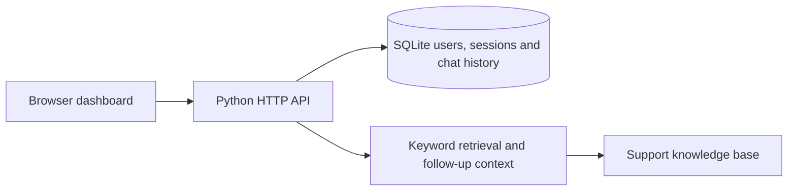

# A Retrieval-Grounded Conversational Banking Assistant for Secure and Context-Aware Customer Support

A local banking support demonstration with a browser dashboard, Python HTTP API, SQLite persistence, and an editable support knowledge base.

## Run locally

Use Python 3.11 or newer with SQLite 3.35 or newer. No third-party packages are required.

```powershell
python app.py
```

Open [the dashboard](http://127.0.0.1:8000). Create an account, ask “I lost my card,” and follow the source link. Try “What if I’m traveling?” to see how a short follow-up retains the previous topic. Log out and back in to verify that your conversation persists. Use **Clear chat** to delete your saved conversation.

## Architecture



The same-origin dashboard calls JSON endpoints. Registration and login issue an expiring opaque session in an HTTP-only, SameSite cookie. SQLite stores salted PBKDF2 password hashes and session-token digests. The API scopes chat access by the authenticated user and revokes the active session on logout.

The retriever searches the keyword sets in `knowledge.json` and returns the selected passage with its source ID. Short, ambiguous follow-ups can reuse the immediately previous source. Unclear matches trigger a request for clarification. Edit the knowledge file and restart the app to update the guides.

| Method | Route | Purpose |
|---|---|---|
| GET | `/api/session` | Read the current profile |
| POST | `/api/register` | Create an account and start a session |
| POST | `/api/login` | Verify credentials and start a session |
| POST | `/api/logout` | Revoke the current session |
| GET | `/api/sources` | Read the public support guides |
| GET | `/api/chat` | Load the latest 100 saved turns |
| POST | `/api/chat` | Retrieve an answer and save the turn |
| POST | `/api/chat/clear` | Delete the signed-in user's conversation |

## Scope

The guides contain general sample support content. Retrieval is deterministic and uses no LLM or external API. Accounts belong to this demo. The built-in server defaults to loopback HTTP and is intended for local use. Use fictional account details. Chat history is stored locally as plaintext, and the sensitive-input check only catches common patterns.

Set `BANK_PORT` to change the port or `BANK_DB` to change the SQLite path. Use `BANK_SECURE_COOKIE=1` when serving behind HTTPS.

## Deploy to Vercel

1. Create or connect a PostgreSQL database in the Vercel project’s Storage tab. Add its connection string as a sensitive `DATABASE_URL` environment variable for Production. Use a separate database for Preview if you enable preview deployments. The database role needs permission to create tables in the target schema.
2. From this project folder, authenticate and link the project with the Vercel CLI. Select the same project where you configured the database.

   ```powershell
   npx.cmd vercel login
   npx.cmd vercel link
   npx.cmd vercel --prod
   ```

3. Open the deployment URL. Create a demo account, ask a question, then log out and log back in to confirm that the chat persists.

The dashboard is served from `web/`. The Python function handles `/api/*` and initializes its PostgreSQL schema on the first database-backed request. The deployed app uses secure HTTPS session cookies. Local SQLite accounts and chat history are excluded from deployment.
